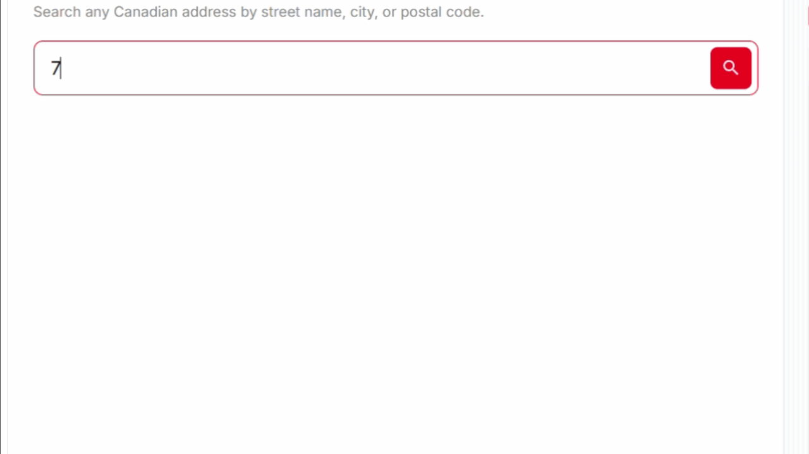
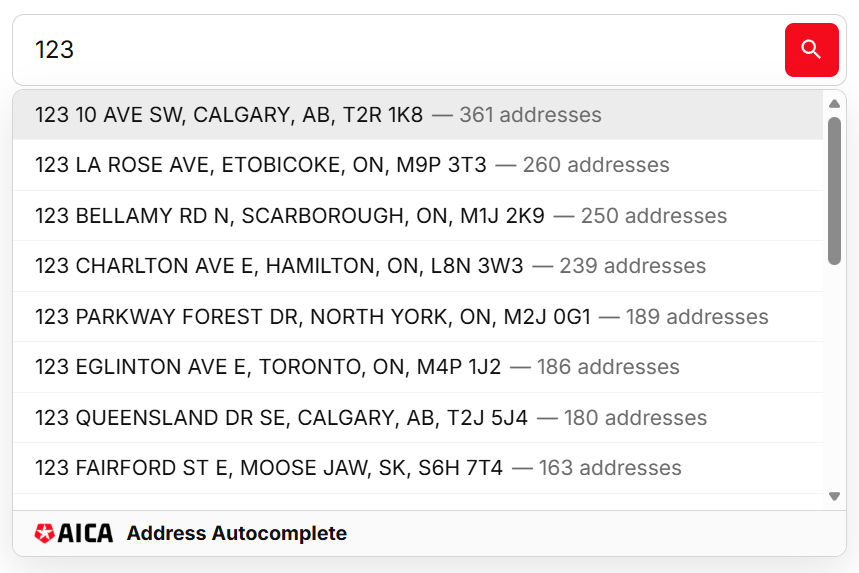
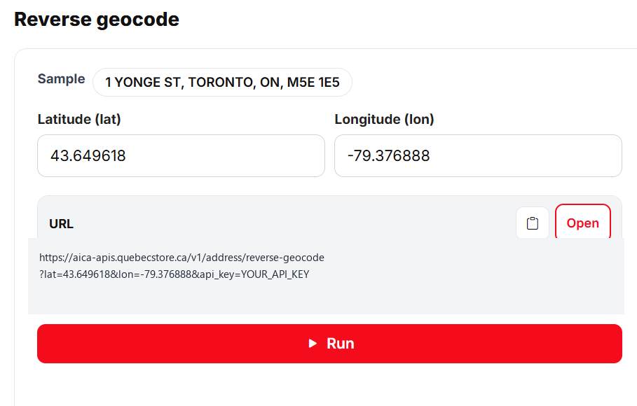

# AICA Address Autocomplete



Autocomplétion, validation et géocodage inverse d’adresses canadiennes. Après 3 frappes, suggestions civiques ; vérifier qu’une adresse saisie correspond à un enregistrement réel ou à la plus proche ; convertir latitude/longitude en adresse voisine. Widget et API REST pour formulaires et paiement. HTTPS. Canada seulement.

Dépôt public d’intégration : widget, exemples JSON, captures, et fichiers pour agents de code (`AGENTS.md`, `llms.txt`).

| | |
|---|---|
| Site | https://aicaaddresscomplete.com/?lang=fr |
| Essayer le widget | https://aicaaddresscomplete.com/try-free-address-autocomplete-api?lang=fr |
| Documentation | https://aicaaddresscomplete.com/documentation?lang=fr |
| Tarifs | https://aicaaddresscomplete.com/pricing?lang=fr |
| Compte | https://aica-apis.quebecstore.ca/aica-adresse-auto-complete/ |
| API autocomplete | https://aica-apis.quebecstore.ca/v1/address/autocomplete |

Canada seulement. Pas de codes ZIP américains.

## Avant d’appeler l’API

Il faut une clé `aica_live_…` : [créer un compte](https://aica-apis.quebecstore.ca/aica-adresse-auto-complete/account/register), [créer une clé](https://aica-apis.quebecstore.ca/aica-adresse-auto-complete/account/dashboard/api-manage), autoriser le domaine du site (ex. `example.com`) et l’IP serveur si vous en avez une. Pour utiliser la clé en production, prenez un [abonnement ou des crédits](https://aicaaddresscomplete.com/pricing?lang=fr). Gardez la clé dans un `.env` ou un coffre — pas dans git.

## Widget



```html
<script src="https://aica-apis.quebecstore.ca/v1/address/autocomplete/canada/interactive/aica-loader.js" async></script>
<div data-aica-autocomplete data-api-key="aica_live_YOUR_WIDGET_KEY"></div>
```

Pas d’iframe / embed / object. La CSP du site doit autoriser `https://aica-apis.quebecstore.ca`.

## Exemples d’API

- Sélection d’adresse : [`examples/autocomplete-select.json`](examples/autocomplete-select.json)
- Validation (plusieurs choix) : [`examples/validate.json`](examples/validate.json)
- Géocodage inverse : [`examples/reverse-geocode.json`](examples/reverse-geocode.json)



Guide complet pour les agents : [`AGENTS.md`](AGENTS.md). Documentation HTML : https://aicaaddresscomplete.com/documentation?lang=fr

Contact : sales@quebecstore.ca · +1 819-452-4162

Licence : [MIT](LICENSE) pour ce dépôt (widget, exemples, docs). L’API hébergée reste un service commercial — compte et abonnement ou crédits requis.
